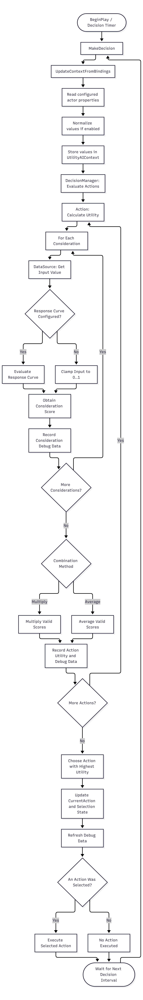

# Utility AI Plugin for Unreal Engine

A modular Utility AI framework developed as an Unreal Engine plugin. The framework allows AI agents to evaluate available actions based on contextual information and select the action with the highest utility.

The goal of this project is to provide a reusable and designer-friendly alternative for implementing AI decision making in Unreal Engine.

## Features

- **Utility-based action selection:** Evaluates available actions and selects the most suitable one based on its utility score.
- **Configurable considerations:** Actions can be evaluated using multiple considerations.
- **Response curves:** Consideration values can be mapped using configurable response curves.
- **Utility combination methods:** Multiple consideration scores can be combined using different methods.
- **Context system:** Stores named values that can be used to evaluate AI actions.
- **Value bindings:** Context values can be connected to properties stored on the AI agent, with optional normalization.
- **Debugging tools:** Visualizes action utilities, consideration scores and response curves.
- **Unreal Engine integration:** Provides editor-facing configuration to create and modify Utility AI behaviours.
- **Documentation:** Includes Doxygen documentation and diagrams explaining the framework.

## Framework Architecture

The framework is built around several main classes:

- **Utility AI Component:** Manages the runtime decision-making process, context updates and action execution.
- **Utility AI Decision Manager:** Evaluates available actions and selects the action with the highest utility.
- **Utility AI Action:** Contains the considerations used to calculate an action's utility.
- **Utility AI Consideration:** Evaluates a specific factor that influences the suitability of an action.
- **Utility AI Context:** Stores named values used by considerations.
- **Utility AI Data Source:** Retrieves values from the context.
- **Utility AI Response Curve:** Maps input values to utility scores.

## Action Selection Pipeline

The following diagram shows the process through which the framework evaluates actions and selects the best action.

## Class Diagram

The following diagram shows the main classes of the framework and their relationships.

## Debugger

The plugin includes a custom debugger that helps visualize the decision-making process.

The debugger displays:
- The available actions and their utility scores.
- The considerations belonging to an action.
- Individual consideration scores using progress bars.
- The response curve of a selected consideration.
- The current position of a consideration on its response curve.

This makes it easier to understand why an AI agent selects a particular action.

## Installation

1. Download or clone the repository.
2. Place the Utility AI plugin in the `Plugins` directory of your Unreal Engine project.
3. Open the Unreal Engine project.
4. Enable the Utility AI plugin if it is not already enabled.
5. Compile the project if required.

## Documentation

The project includes Doxygen documentation covering the framework's classes, functions and parameters.

The documentation and diagrams are available in the GitHub repository.

Here is a link to the documentation: [DoxygenDocumentation](https://annedegeus01.github.io/UtilityAIProject/index.html)
